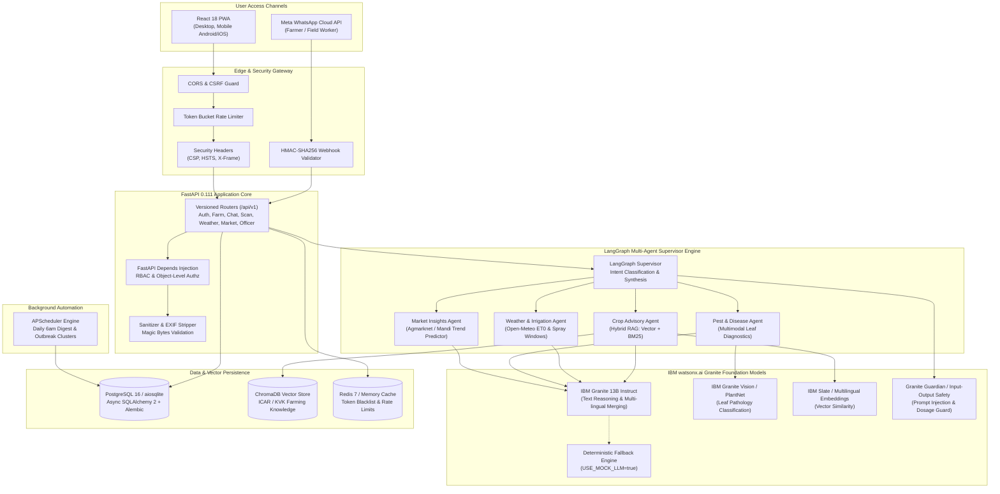

# KisanSathi — System Architecture

## 1. High-Level Architecture Diagram (Mermaid)

## 2. Agent Interaction & Data Flow
1. **Request Intake:** A user message arrives via Web Chat or WhatsApp Webhook.
2. **Intent Classification:** Supervisor determines intent (`advisory`, `weather`, `disease_photo`, `market`, `general`).
3. **Parallel Dispatch:** If query spans multiple domains (e.g., "Can I irrigate and spray urea on my cotton tomorrow?"), Supervisor fans out to `crop_advisory` and `weather_irrigation` simultaneously via `asyncio.gather`.
4. **Safety & Guardrails:** Granite Guardian validates that no non-farming prompts, prompt injections, or unauthorized chemical dosages are processed.
5. **Synthesis:** Supervisor combines agent responses into a concise, actionable answer in Gujarati/Hindi/English with verified citations.
