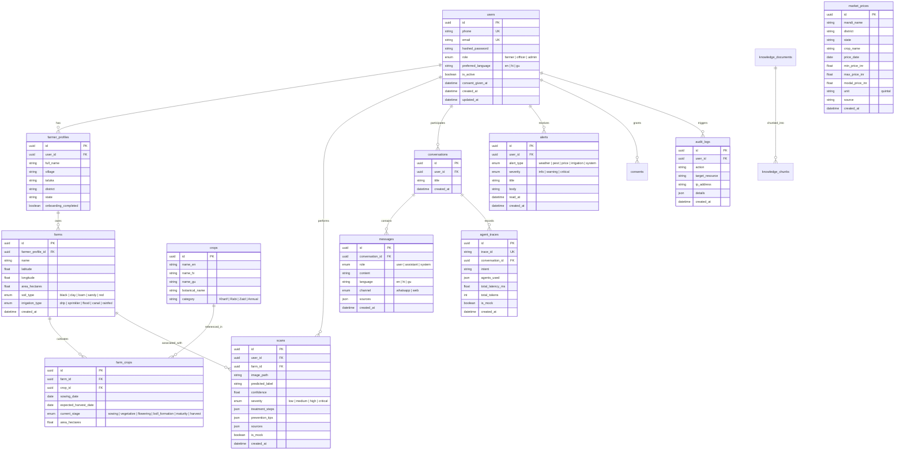

# KisanSathi — Database Entity Relationship Diagram (ERD)

## 1. Relational Schema Diagram (Mermaid)

## 2. Constraints & Indexing Strategy
- **UUIDs everywhere:** All primary keys utilize RFC 4122 Version 4 UUIDs for secure distributed sharding and no enumerability attacks.
- **Indexes:**
  - `market_prices (crop_name, mandi_name, price_date DESC)` for fast mandi time-series charting.
  - `scans (user_id, created_at DESC)` for farmer scan history gallery.
  - `scans (predicted_label, created_at)` for spatial outbreak cluster grouping.
  - `alerts (user_id, read_at)` for quick unread badge count queries.
  - `farm_crops (farm_id, current_stage)` for crop stage timeline overlays.
