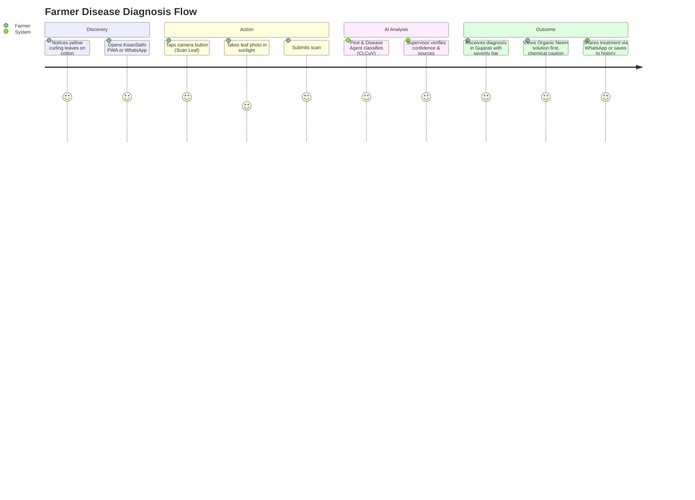
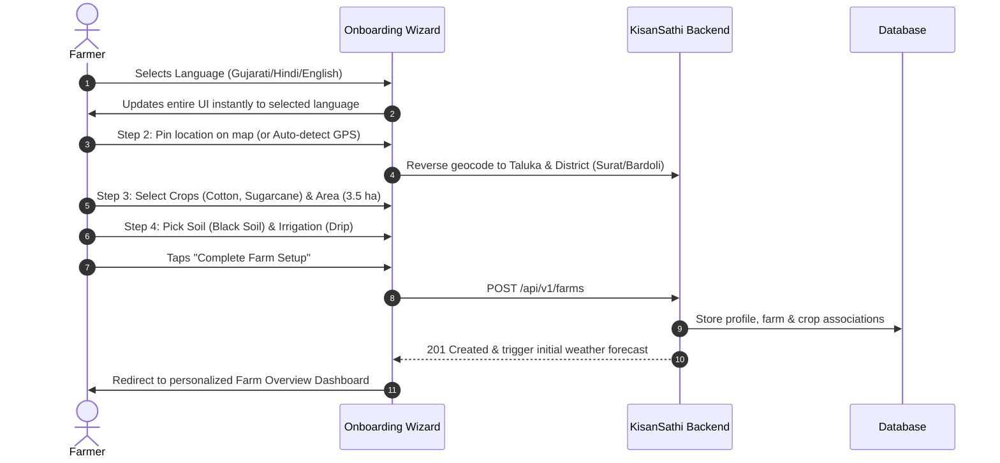

# KisanSathi — User Journeys

## Journey 1: Farmer Rapid Leaf Scan & Disease Treatment (Critical Golden Path)
**Goal:** Arjun discovers curling yellow leaves on his cotton crop and gets actionable cure in <10 seconds.

**Steps:**
1. **Entry:** Farmer taps "Scan Leaf" tile on Farm Overview (or sends image to WhatsApp bot).
2. **Capture/Preview:** Camera interface opens with overlay frame. Client compresses image (<1MB) and strips EXIF GPS data for privacy.
3. **Execution:** Multimodal Pest & Disease Agent predicts condition ("Cotton Leaf Curl Virus", 87% confidence, Medium Severity).
4. **Presentation:** High-contrast card with:
   - Clear disease name in farmer's language (કપાસ પર્ણ વલન વાયરસ).
   - Visual severity badge (Amber / Medium).
   - Step 1: Immediate physical quarantine (remove affected plant).
   - Step 2: Organic-first remedy (Neem oil spray 5ml/L).
   - Step 3: Chemical caution (Imidacloprid 17.8 SL @ 0.5 ml/L, ICAR citation).
5. **Follow-up:** One-tap action "Ask AI Question about this leaf" opens chat with pre-filled context.

---

## Journey 2: Onboarding & Farm Setup (First-Time User)
**Goal:** Setup farm profile in 4 steps within 90 seconds without typing tedious forms.

---

## Journey 3: Agri Extension Officer Outbreak Monitoring & Triage
**Goal:** Officer Ramesh tracks pest hot-spots across 3 districts and issues early advisories.

1. **Dashboard Entry:** Officer logs in with Gov/KVK credentials. Navigates to `/officer`.
2. **Spatial Risk Map:** Interactive Leaflet map renders farms and scan clusters with color-coded risk markers (Red: high pest density, Amber: moderate, Green: healthy).
3. **Cluster Investigation:** Clicks a cluster in Bardoli; sees 14 recent scans of Pink Bollworm within 5km radius.
4. **Action:** Clicks "Dispatch Taluka Advisory" -> Sends automated advisory to all farmers registered with Cotton in Bardoli.
5. **Export:** Clicks "Export Incident CSV" for weekly report to District Agriculture Officer.
